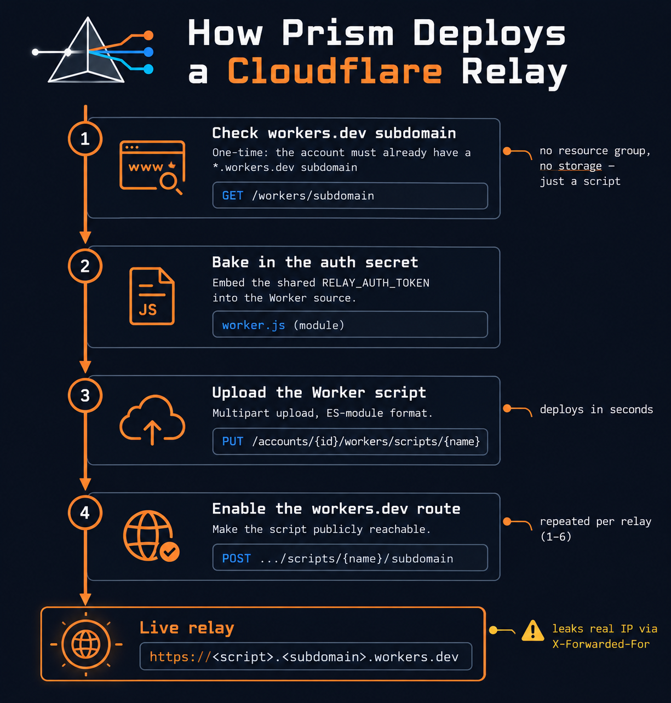
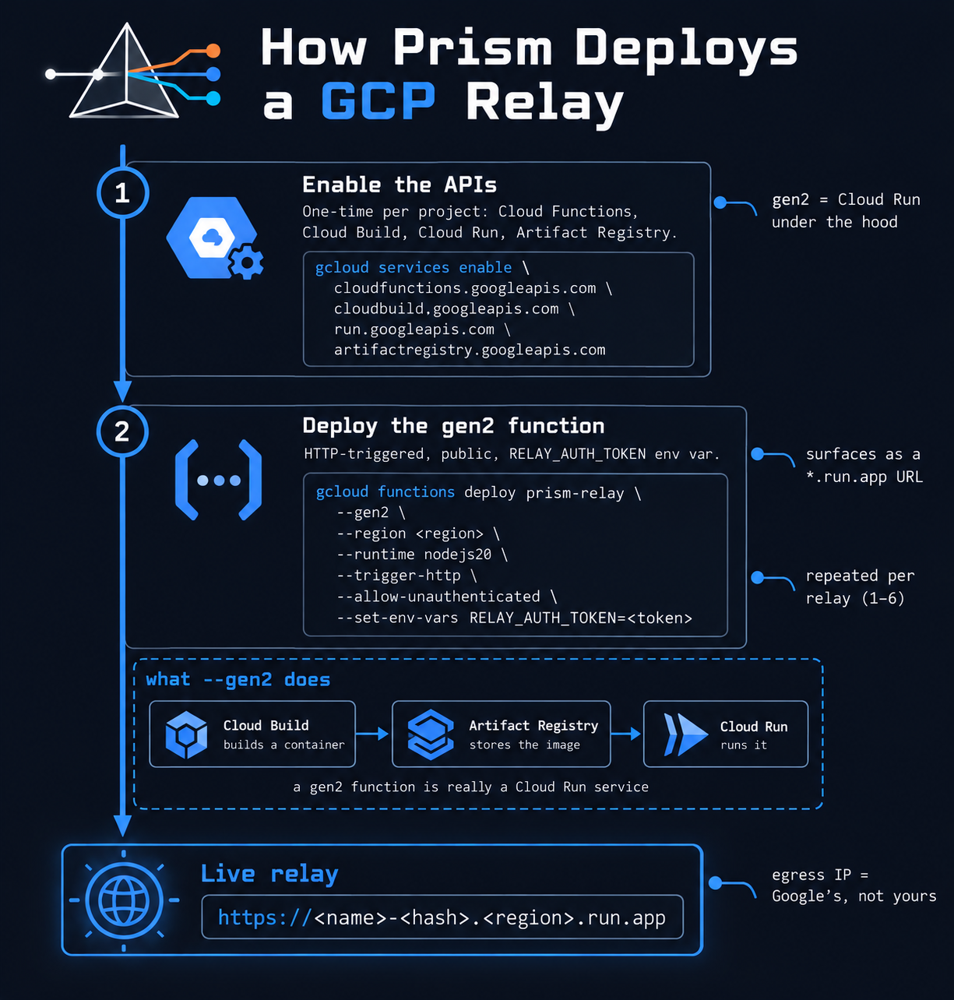
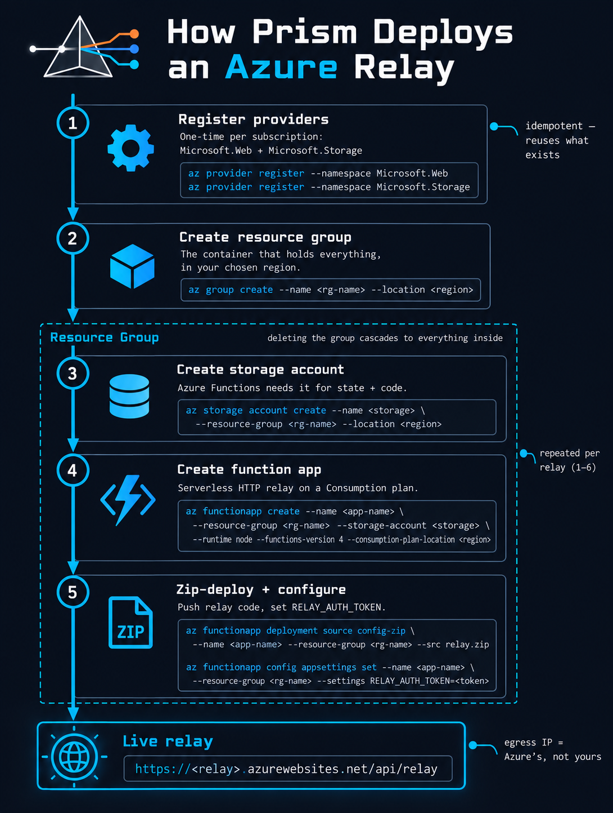

<p align="center">
  
</p>

# Prism

<p align="center">
  <a href="LICENSE"></a>
  
  
  
</p>

Rotating-source-IP proxy infrastructure for authorized red-team engagements, built on
serverless cloud functions instead of AWS EC2 + SSH SOCKS tunnels. A pool of disposable
"relays" forwards HTTP(S) traffic to your target so it sees cloud-provider edge/egress
IPs instead of your real IP or a single static VPS IP. **Pick a provider** — Cloudflare
Workers, GCP Cloud Functions, or Azure Functions — the wizard walks you through whichever
one you choose, and everything else (the local rotator, sticky sessions, pacing, the
`test`/`list`/`down` commands) works identically regardless of which one is active.

This is not a novel technique — the Cloudflare path mirrors the publicly documented
[HackTricks Cloudflare Workers pass-through proxy](https://book.hacktricks.wiki/en/network-services-pentesting/pentesting-web/cloudflare.html)
pattern and tools like [FlareProx](https://github.com/MrTurvey/flareprox) and
[cf-proxy](https://github.com/LvMalware/cf-proxy); GCP Cloud Functions and Azure Functions
extend the same idea to their own serverless HTTP compute products.

> **Why only these three?** Not every "edge compute" or "CDN" product can do this.
> Cloudflare Workers, GCP Cloud Functions, and Azure Functions can all make an outbound
> `fetch()`/HTTP request to an arbitrary caller-supplied URL. Akamai EdgeWorkers, by
> contrast, can only make subrequests to hostnames already onboarded as an Akamai-delivered
> property — no arbitrary relay possible. Fastly Compute and plain AWS Lambda (or
> Lambda@Edge) are technically viable the same way GCP/Azure are, just not built here yet.
> Pure CDN products (Azure CDN, Akamai's core CDN) have no code-execution layer at all —
> they cache your own origin's content, they don't relay to arbitrary third parties.

> **Authorization reminder:** only point this at systems you're explicitly authorized to
> test. Cloudflare's Terms of Service and Acceptable Use Policy apply to Workers traffic
> like any other Cloudflare product. Tear the relays down (`prism down`) when the
> engagement ends. `worker.js` is an open relay to anyone holding `RELAY_AUTH_TOKEN` —
> treat that token like a credential and rotate it between engagements.

> **HTTP(S) traffic only — not raw TCP.** Cloudflare Workers can only make outbound
> requests via `fetch()`, not open arbitrary raw TCP sockets to the final target, so there's
> no generic port-level proxying here regardless of how you connect to the local rotator.
> It's suited to browser/Burp traffic and HTTP-aware tools (httpx, nuclei, ffuf, curl) — not
> `nmap`-style port scans or anything that isn't plain HTTP(S). `up --socks5` runs the local
> rotator as a SOCKS5 listener instead of HTTP(S) — this only changes how a *client connects
> to the rotator* (useful for tools with no `--proxy` flag of their own, wrapped via
> `proxychains`), it does **not** add raw TCP/port-scanning capability; the relay chain
> behind it is still HTTP(S)-only end to end. See [Limitations](#limitations) below for the
> full picture, including why the AWS/EC2 version is still the right tool for SOCKS-level
> rotation.

## Contents

- [What's in here](#whats-in-here)
- [Prerequisites](#prerequisites)
- [Choosing a provider](#choosing-a-provider)
- [Cloudflare Workers setup](#cloudflare-workers-setup)
- [GCP Cloud Functions setup](#gcp-cloud-functions-setup)
- [Azure Functions setup](#azure-functions-setup)
- [Install](#install)
- [Run it](#run-it)
- [Example usage](#example-usage-once-the-rotator-is-running)
- [Config file (`prism.json`)](#config-file-prismjson)
- [Tear-down & cost check](#verifying-everything-is-torn-down-avoiding-lingering-costs)
- [Testing](#testing)
- [Limitations](#limitations)
- [Acknowledgments](#acknowledgments)

## What's in here

| File | Role |
|---|---|
| [`prism/cli.py`](prism/cli.py) | **Start here.** Single-command orchestrator behind the `prism` command: provider + config wizard, deploy, run the local rotator, teardown. Dispatches to whichever backend below is active. |
| [`prism/relay_common.py`](prism/relay_common.py) | Provider-agnostic pieces shared by all three backends: config/endpoints file I/O, relay-prefix generation, the canary test. |
| [`prism/worker.js`](prism/worker.js) | The Cloudflare relay — a Worker. Forwards a request to whatever URL is in `X-Target-URL` and returns the response. |
| [`prism/cloudflare_relay_manager.py`](prism/cloudflare_relay_manager.py) | Cloudflare backend — drives the Cloudflare API to deploy/list/test/delete Workers. |
| [`prism/gcp_relay_function/`](prism/gcp_relay_function/main.py) | The GCP relay — a 2nd-gen HTTP Cloud Function. Same wire protocol as `worker.js`. |
| [`prism/gcp_relay_manager.py`](prism/gcp_relay_manager.py) | GCP backend — drives the `gcloud` CLI to deploy/list/test/delete Cloud Functions. |
| [`prism/azure_relay_function/`](prism/azure_relay_function/function_app.py) | The Azure relay — a Python v2-model HTTP function. Same wire protocol as `worker.js`. |
| [`prism/azure_relay_manager.py`](prism/azure_relay_manager.py) | Azure backend — drives the `az` CLI (resource group, storage account, function app, zip deploy). |
| [`prism/rotator_addon.py`](prism/rotator_addon.py) | An `mitmproxy` addon, provider-agnostic. Terminates TLS locally and, per request, picks a relay + User-Agent from `endpoints.json` and replays the request through it. |
| [`prism/useragents.json`](prism/useragents.json) | Pool of realistic User-Agent strings `rotator_addon.py` rotates through. |
| [`pyproject.toml`](pyproject.toml) | Packaging metadata — makes Prism installable (and its `prism` command available) via `pipx install .` / `pip install`. |
| [`endpoints.json`](endpoints.json.example) | Auto-generated in your working directory: the list of deployed relay URLs, tagged with which provider deployed each one. |
| [`prism.json`](prism.json.example) | Your config: which provider, its credentials, and the shared relay auth secret. **Never commit this file.** |
| [`wrangler.toml`](wrangler.toml) | Optional manual single-Worker deploy path via the official Wrangler CLI, if you don't need `cloudflare_relay_manager.py`'s bulk deploy (Cloudflare only). |

### How a request flows

```
your tool (curl / Burp / httpx / browser)
    -> local mitmproxy on 127.0.0.1:9292 (rotator_addon.py)
    -> a chosen relay (Cloudflare Worker, GCP Cloud Function, or Azure Function)
    -> the real target
```

At the TCP level the target sees that provider's IP as the connecting address — not your
real IP, not the machine running the rotator. All three relays speak the exact same
protocol back to the rotator (`X-Relay-Auth` / `X-Target-URL` headers in, forwarded
response out), so `rotator_addon.py` and `endpoints.json` don't know or care which
provider deployed a given entry.

> **⚠ Cloudflare leaks your real IP via `X-Forwarded-For` (Cloudflare backend only).**
> Cloudflare's network appends the connecting client's IP — the machine running the
> rotator, i.e. *your* real IP — to the `X-Forwarded-For` and `CF-Connecting-IP` headers
> of the Worker's outbound `fetch()`, **after** `worker.js` has run, so the Worker's own
> header-stripping cannot remove it. Any target that reads `X-Forwarded-For` (most web
> servers, WAFs, load balancers, and app frameworks sitting behind a proxy do) will log
> your real IP, even though the raw TCP connection still comes from Cloudflare. Verified
> against a live deploy — a target received `X-Forwarded-For: <your real IP>, <Cloudflare
> IP>` on every request. **GCP and Azure do not do this**: there the target sees only the
> provider's egress IP, in both the connection and the headers (also verified live). This
> is a property of the Cloudflare Workers runtime, not a bug in `worker.js`. If hiding
> your real IP from a header-inspecting target matters, prefer GCP or Azure. See
> [Limitations](#limitations).
>
> **Mitigation if you must use Cloudflare:** set the [`upstream_proxy`](#optional-rotator-behavior-knobs)
> knob to a burner VPS/VPN/Tor. Cloudflare still appends *an* IP — but it's the burner's, not
> yours, since that's now what connects to Cloudflare. The leak stays; what it leaks becomes
> disposable.

> **No custom domain needed or used, on any provider.** Cloudflare relays live under the
> free default `*.workers.dev` subdomain; GCP relays get a `*.cloudfunctions.net`/
> `*.run.app`-style URL; Azure relays get a `*.azurewebsites.net` URL. Every relay name is
> `<relay_prefix>-<random suffix>`, e.g. `myproxy-vjkdah` — the prefix is either one you
> pick yourself or a randomly generated one (the setup wizard asks) — there's no hardcoded
> branding baked into the tool. No DNS setup, no domain purchase, nothing beyond each
> provider's own one-time account setup below.

## Prerequisites

- **Platform: Windows, macOS, or Linux** — every script here (`prism` and the three
  backend modules) is written against `sys.platform`/POSIX branches rather than one OS, so
  nothing platform-specific is Windows-only. The Ctrl+C handling, process management, and
  PATH lookups all have a real Linux/macOS code path, not just a Windows one with a stub
  elsewhere.
- Python 3.10+ (mitmproxy's zstandard dependency can fail to build on other versions)
- An account with whichever provider you pick below

## Choosing a provider

You only need to set up **one** of these three — pick whichever cloud you already have
access to (or want to test detections against). `prism init` asks interactively;
skip straight to whichever section applies and come back once you have credentials.

> 📄 **Which provider trips which detections?** The three clouds present very differently
> to a WAF / IP-intel / SIEM — see [**docs/egress-detection.md**](docs/egress-detection.md)
> for a per-provider breakdown of the detection surfaces (ASN/IP reputation, geolocation,
> TLS fingerprint, headers) and the defensive mirror for blue teams.

`up`/`down`/`list`/`test` all print a color-coded **ACTIVE PROVIDER** banner
before doing anything — 🟠 orange for Cloudflare, 🔴 red for GCP, 🔵 blue for Azure — so
there's never ambiguity about which cloud a command is about to touch, especially now
that switching between three is a normal thing to do. (`status` shows the same
color-coded provider name and sets the terminal title too, just as a one-line summary
rather than the full banner box.) They also set the terminal
window/tab **title** to the same, which — unlike anything printed to the scrolling
output — stays visible for as long as the session runs, even during a long `up` session
once the banner itself has scrolled off screen. Both are skipped automatically when
output isn't a real terminal (redirected to a file, piped, etc.), so they never leak
escape codes into logs.

| | Cloudflare Workers | GCP Cloud Functions | Azure Functions |
|---|---|---|---|
| Setup effort | Lowest — one API token | Medium — `gcloud` CLI + project | Medium-high — `az` CLI + resource group + storage account |
| Deploy speed | Seconds per relay | ~1-2 min per relay | A few minutes per relay (function app create + zip deploy) |
| Cost | Free: 100k req/**day** | Free: 2M req/**month** | Free: 1M exec/**month** |
| External tool needed | None (raw REST calls) | `gcloud` CLI on PATH, `gcloud auth login` | `az` CLI on PATH, `az login` |
| Backend module | [`cloudflare_relay_manager.py`](prism/cloudflare_relay_manager.py) | [`gcp_relay_manager.py`](prism/gcp_relay_manager.py) | [`azure_relay_manager.py`](prism/azure_relay_manager.py) |

### Pricing detail

Checked against each provider's official pricing page directly (not aggregator estimates):

| | Cloudflare Workers | GCP Cloud Functions (2nd gen, billed as Cloud Run) | Azure Functions (Consumption plan) |
|---|---|---|---|
| Free tier | 100,000 requests/**day** (10ms CPU time/invocation included) | 2,000,000 requests/**month**, 180,000 vCPU-seconds, 360,000 GiB-seconds | 1,000,000 executions/**month**, 400,000 GB-seconds |
| Paid base fee | $5/month minimum (Paid plan), includes 10M requests + 30M CPU-ms | None — pure pay-as-you-go | None — pure pay-as-you-go |
| Requests/executions beyond free | $0.30 per additional million | $0.40 per additional million | $0.20 per additional million |
| Compute beyond free | $0.02 per additional million CPU-**milli**seconds | $0.024 per 1,000 vCPU-seconds (~$24/million) + $0.0025 per 1,000 GiB-seconds (~$2.50/million) | $0.000016 per GB-second |

For what this tool actually does — a lightweight pass-through relay, not a compute-heavy
workload — a handful of relays across a normal engagement's request volume will very
likely stay entirely inside every provider's free tier regardless of which you pick. The
real difference is *how* the free tier resets: Cloudflare's is a **daily** cap (100k/day,
so up to ~3M/month if you use it every day), while GCP's and Azure's are flat **monthly**
totals — matters more for a burst-heavy single day than for typical steady use.

Once one provider is deployed, switching to another is safe but **not automatic cleanup**
— see [Switching providers](#switching-providers) below before you do it mid-engagement.

## Cloudflare Workers setup

<p align="center">
  
</p>

1. Sign up (or log in) at [Cloudflare](https://cloudflare.com)
2. Enable a `*.workers.dev` subdomain once for the account, if you haven't already:
   **Workers & Pages → Overview** — Cloudflare prompts you to choose one the first
   time you visit. This becomes part of every relay's URL:
   `https://<relay-name>.<your-subdomain>.workers.dev`
3. Go to [API Tokens](https://dash.cloudflare.com/profile/api-tokens)
   (top-right user icon → **My Profile → API Tokens** also gets you there)
4. Click **Create Token** and use the **"Edit Cloudflare Workers"** template
5. Set the **Account Resources** and **Zone Resources** to **All**. Click
   **Continue to summary**
6. Click **Create Token** and copy the token — Cloudflare only shows it once. This is
   the value you'll paste in as `api_token`

Before you click Create Token, Cloudflare shows a permissions summary — it should look
like this (exact permission names can shift slightly as Cloudflare adds products, but
it should always be scoped to Workers/account-level editing, not zone DNS or billing):

```
This API token will affect the below accounts and zones, along with their respective permissions

├─ All accounts - Workers Agents Configuration:Edit, Containers:Edit, Workers Observability:Edit,
│                  Workers Builds Configuration:Edit, Cloudflare Pages:Edit, Workers R2 Storage:Edit,
│                  Workers Tail:Read, Workers KV Storage:Edit, Workers Scripts:Edit, Account Settings:Read
├─ All zones    - Workers Routes:Edit
└─ All users    - Memberships:Read, User Details:Read
```

Then grab your **Account ID** — shown in the right-hand sidebar of any zone or account
dashboard page (**Workers & Pages → Overview** also shows it), and also visible directly
in the browser URL once you're in the dashboard: `https://dash.cloudflare.com/<account-id>/...`.
This is your `account_id`.

## GCP Cloud Functions setup

<p align="center">
  
</p>

1. Sign up (or log in) at [console.cloud.google.com](https://console.cloud.google.com)
2. Install the [gcloud CLI](https://cloud.google.com/sdk/docs/install) — this tool shells
   out to it rather than reimplementing Google's deploy API directly, the same way
   [`wrangler.toml`](wrangler.toml) exists as the officially-supported Cloudflare path.
   **Linux/macOS:** Google's own official installer script works on both:
   ```bash
   curl -sSL https://sdk.cloud.google.com | bash
   ```
3. Authenticate once: `gcloud auth login`
4. Pick a **project ID** for `gcp_project_id` — either an existing project's ID (not its
   display name — find it on the project dashboard or via `gcloud config get-value
   project`), or, if you don't have one yet, just make one up (or leave the wizard's
   prompt blank for a random one): `up` creates the project automatically the first time
   it deploys if that ID doesn't exist yet, and enables the required APIs
   (`cloudfunctions.googleapis.com`, `cloudbuild.googleapis.com`, `run.googleapis.com`,
   `artifactregistry.googleapis.com` — 2nd-gen Cloud Functions run on Cloud Run under the
   hood, hence the extra two) on it automatically too. Project IDs follow GCP's own
   syntax rules regardless of which path you take: lowercase letters, digits, and
   hyphens only (**no underscores**), must start with a letter, 6-30 characters — the
   wizard validates this and rejects anything else before it ever reaches `gcloud`.
5. Have a billing account linked to your project — this is the one part creation can't
   automate. A brand-new project has no billing account attached, and enabling the APIs
   above (even for usage that stays inside the free tier) requires one.
   - Check whether you already have a billing account on your Google account:
     ```bash
     gcloud billing accounts list
     ```
     If that lists something, skip to the link step below.
   - **Nothing listed?** Create one at
     [console.cloud.google.com/billing](https://console.cloud.google.com/billing) →
     **Add billing account**. It asks for a payment method for identity verification, but
     new Google Cloud accounts get a free trial confirmed straight off Google's own
     sign-up screen: **$300 in free credits, 90 days to spend them, and "No billing
     during trial"** (its exact wording) — this project's usage fits well inside that
     (see [Pricing detail](#pricing-detail) above). Nothing is charged to the card during
     the trial; you'd have to explicitly click through to upgrade afterward for billing
     to start.
     > **Some payment methods get a "One-time prepayment required" prompt instead** — a
     > refundable deposit (Google's own example: **$50.00**), charged once, credited to
     > your account, *before* the free trial credits and free trial activate — not a
     > recurring or usage charge. Google's own text on this screen confirms it's
     > **refundable if you close the Cloud Billing account**. Whether you see this at all
     > depends on your payment method/region — plenty of accounts go straight to the
     > free trial with no prepayment prompt at all.
     >
     > If you do hit it, the console then shows **"Your Free Trial is pending"** — either
     > the prepayment hasn't been made yet (click **Make a payment** if so) or it's still
     > processing, and Google's own text on that screen says **products and services may
     > be limited for up to 24 hours** while it clears. This is a separate wait from
     > linking the billing account below — the link can succeed while the trial is still
     > pending, and API-enable/deploy will keep failing until the trial actually
     > activates. If `up` still fails right after you've linked billing, this pending
     > window is the most likely reason — just wait and retry.
   - **Link the billing account to your project — pick whichever you prefer:**

     **`gcloud` CLI:**
     ```bash
     gcloud billing projects link <your-project-id> --billing-account=<ACCOUNT_ID>
     ```
     `<ACCOUNT_ID>` is the `ACCOUNT_ID` column from the `accounts list` output above
     (formatted like `XXXXXX-XXXXXX-XXXXXX`, not the display name).

     **Console (no CLI needed):**
     1. Go to
        [console.cloud.google.com/billing/linkedaccount?project=\<your-project-id\>](https://console.cloud.google.com/billing/linkedaccount)
        — substitute your actual project ID in place of `<your-project-id>` in that URL.
        This jumps straight to the "link a billing account" page for that specific
        project, skipping the project picker.
     2. Pick your billing account from the dropdown shown.
     3. Click **Set account** (Google occasionally relabels this button — **Link** does
        the same thing if that's what you see instead).

     If that direct link ever misbehaves, the manual click-path is the same destination
     with more steps: [console.cloud.google.com/billing](https://console.cloud.google.com/billing)
     → **My Projects** in the left sidebar (lists every project and whether it currently
     has billing linked) → find your project → **⋮** (three-dot menu) → **Change
     billing** (or **Link a billing account** if none is linked yet) → pick the account →
     **Set account**.
   - If `up` hits a missing-billing error mid-deploy (rather than you doing this ahead of
     time), it prints the `gcloud` command above itself — just run it (or use the console
     steps above instead) and re-run `up`;
     it picks up from where it stopped rather than starting over.
6. Pick a region for `gcp_region` (default `us-central1` if you don't have a preference —
   [list of regions](https://cloud.google.com/functions/docs/locations))

Deployed relays are 2nd-gen HTTP Cloud Functions with `--allow-unauthenticated` (public,
same as a Cloudflare Worker's default) — the shared `auth_token` in your config is what
actually gates access, not GCP's own IAM, exactly like `worker.js`.

## Azure Functions setup

<p align="center">
  
</p>

**Prerequisites at a glance:**
- An Azure account with an active subscription — [portal.azure.com](https://portal.azure.com)
  (free trial or pay-as-you-go both work)
- **Contributor** access (or equivalent) on that subscription, or at least on the target
  resource group if it already exists — needed to create/delete resource groups, storage
  accounts, and Function Apps. If you own the subscription yourself, this is already true
  and nothing to set up; it only matters on a shared/corporate subscription with
  restricted roles
- The `az` CLI installed, on `PATH`, and authenticated (`az login`) — see step 2 below
- Python 3.10+ locally with this repo's `requirements.txt` installed (same as any provider)

What it does **not** require: no custom domain/DNS, no pre-created resource group or
storage account (both are provisioned automatically), no separate Azure Functions Core
Tools install, and no manual function-key management (the relay uses
`http_auth_level=ANONYMOUS` and is gated by the shared `auth_token` instead — see below).
For cost, see [Pricing detail](#pricing-detail) above — this workload fits the free tier
for any normal engagement.

**Which account should you authenticate with?** Two separate permission systems are easy
to conflate here: **tenant/Global Administrator** is an Entra ID *directory* role (manages
users, policies, etc.) — this tool needs none of that. What actually matters is **Azure
RBAC**: `Contributor` (or equivalent) on the subscription, or just on the target resource
group. If this is a personal test tenant you created yourself, your own account is
typically already both Global Admin of the tenant *and* Owner of its initial
subscription — plenty for `az login --tenant ...` with no extra setup.

For repeated/scoped use (arguably the better practice for red-team tooling — narrows the
blast radius if a credential ever leaked, and skips interactive login prompts entirely),
create a dedicated service principal scoped to one resource group instead of using your
own account:
```bash
az group create --name myrelay-rg --location eastus         # create it first --
                                                              # the SP needs something
                                                              # that already exists to scope to
az account show --query id -o tsv                            # note your subscription ID
az ad sp create-for-rbac --name "prism-relay-sp" --role Contributor \
  --scopes /subscriptions/<subscription-id>/resourceGroups/myrelay-rg
# returns JSON with appId / password / tenant -- then:
az login --service-principal -u <appId> -p <password> --tenant <tenant-id>
```
Set `azure_resource_group` to `myrelay-rg` in the wizard to match. This tool doesn't
manage Azure credentials itself — `azure_relay_manager.py` just uses whichever identity
`az` is currently logged in as, so this is entirely an `az login` decision made before
running `prism`, not something configured in this project.

1. Sign up (or log in) at [portal.azure.com](https://portal.azure.com)
2. Install the [az CLI](https://learn.microsoft.com/cli/azure/install-azure-cli) — this
   tool shells out to it (including a zip-deploy for the actual code) rather than
   reimplementing Azure's ARM/Kudu APIs directly.
   - **Windows:** **If you install it with `winget`, open a brand-new terminal window
     afterward** — `winget` updates PATH, but any terminal already open when it ran won't
     see the change until it's restarted (you'll get "az CLI not found on PATH" otherwise,
     even right after a successful install)
   - **Linux (Debian/Ubuntu):**
     ```bash
     curl -sL https://aka.ms/InstallAzureCLIDeb | sudo bash
     ```
     Other distros (Fedora/RHEL/etc.): see [the Linux install
     page](https://learn.microsoft.com/cli/azure/install-azure-cli-linux) for the
     equivalent `dnf`/`yum`/`zypper` steps.
     > **On Kali (or Debian testing/sid) specifically:** the command above may say it
     > can't find a package for your system and offer `sudo apt install azure-cli` as a
     > fallback — **say no.** That fallback installs Kali's own `azure-cli` package from
     > its default repo, not Microsoft's, and it's a confirmed source of internal crashes
     > (`'NoneType' object is not callable`, thrown deep inside az's own `knack`/
     > `azure.cli.core` code — a Python traceback, not a real az error message — that
     > `up` will now detect and refuse to proceed past, rather than let you hit it
     > confusingly mid-deploy). Instead, tell the installer which Debian release to target
     > explicitly, since Kali's own codename isn't one it recognizes:
     > ```bash
     > curl -sL https://aka.ms/InstallAzureCLIDeb | sudo DIST_CODE=bookworm bash
     > ```
     > (If `bookworm` ever stops working, check
     > [packages.microsoft.com/repos/azure-cli/dists](https://packages.microsoft.com/repos/azure-cli/dists/)
     > for whatever codename is currently published.) Confirm it worked before running
     > `up`: `which az` should print `/opt/az/bin/az`, **not** `/usr/bin/az` — the latter
     > means the distro package is still what's on `PATH`.
   - **macOS:** `brew update && brew install azure-cli`
3. Authenticate once: `az login`. **We suggest using your own tenant** (a personal test
   tenant is fine — no need for Global Admin, just Contributor on the subscription/
   resource group, which you'll typically already have as the tenant's creator) **with
   your tenant's account (e.g. `you@yourtenant.onmicrosoft.com`), not a personal Microsoft
   account** (`outlook.com`/`hotmail.com`/`live.com`) — a personal account won't exist in
   your tenant's directory and everything this tool creates needs to live under your
   tenant's subscription anyway. **At the sign-in prompt, click "Work or school account"
   — not "Personal account"** — picking the wrong one is exactly what causes "Microsoft
   account does not exist" (AADSTS50020) even with the right credentials. If you still hit
   that error, or the prompt is ambiguous about which tenant to use, pass
   `--tenant <tenant-id-or-domain>` to point `az login` at it directly (find the tenant ID
   or domain in the Azure Portal → **Microsoft Entra ID** → **Overview**). If the
   browser-based login also fails or gets cancelled, see
   [Troubleshooting: `az login` fails](#troubleshooting-az-login-fails-with-user-cancelled-in-transfer-token-flow)
   below for the device-code fallback
4. **Make sure a subscription is attached to that tenant.** A **tenant** and a
   **subscription** are two different things, easy to conflate:
   - The **tenant** is the directory/identity container — what you just authenticated
     into with `az login` (`yourtenant.onmicrosoft.com`, in the earlier example).
   - The **subscription** is the separate billing container that actually lets you
     create resources — a resource group, storage account, or Function App has to live
     *in* a subscription. A freshly created tenant (especially a test/dev one made
     directly in Entra ID) has **no subscription attached by default**.

   Check whether one exists:
   ```powershell
   az account list --output table
   ```
   If nothing is listed, sign in to [portal.azure.com](https://portal.azure.com) **as
   that tenant's account** (not a different identity — otherwise the subscription lands
   under the wrong tenant), then go to [azure.microsoft.com/free](https://azure.microsoft.com/en-us/free/)
   to attach a free trial subscription to it. Current terms: $200 credit for 30 days,
   plus a set of services free for 12 months and ongoing free-tier quotas after that — a
   card is required for identity verification but isn't charged unless you explicitly
   upgrade to pay-as-you-go. Re-run `az account list --output table` afterward to confirm
   it now shows up under your tenant.

   Avoid the `--allow-no-subscriptions` flag `az login` may suggest here — it lets you
   authenticate at the tenant level without a subscription, but this tool needs an actual
   subscription to deploy anything into, so that flag gets you past the login prompt
   without solving the actual problem.

   You do **not** need to manually register the `Microsoft.Web`/`Microsoft.Storage`
   resource providers yourself — `up` checks and registers both automatically on first
   deploy (one-time per subscription, can take a minute). Without this, a brand-new
   subscription's missing `Microsoft.Storage` registration produces a badly misleading
   error: `az storage account create` fails with `(SubscriptionNotFound) Subscription
   <id> was not found` even though the subscription is completely valid — if you ever
   see that error running the tool's commands directly instead of through `up`, that's
   almost always the real cause; fix it with
   `az provider register --namespace Microsoft.Storage`.
5. Pick (or let the wizard generate) three values:
   - `azure_resource_group` — a **resource group** is just a folder Azure uses to group
     related resources together (the function apps this tool deploys, plus their storage
     account) so they can be managed, billed, and deleted as one unit. It isn't itself
     billed, and deleting it deletes everything inside it in one shot. Any name works —
     it's created automatically on first deploy if it doesn't already exist. List
     existing ones with `az group list -o table`
   - `azure_storage_account` — Azure Functions require a **storage account** behind the
     scenes to keep track of function code, triggers, and internal state — it's plumbing
     Azure needs to run your functions, not something you interact with directly here.
     One is shared across every relay in this config, not created per-relay. Names must
     be **globally unique across all of Azure**: lowercase letters and digits only, 3-24
     characters, no hyphens
   - `azure_region` — default `eastus` if you don't have a preference

Deployed relays are Python v2-model Function Apps on a Linux Consumption plan with
`http_auth_level=ANONYMOUS` (public, same as a Cloudflare Worker's default) — the shared
`auth_token` in your config is what actually gates access, not Azure's own function keys,
exactly like `worker.js`. Code is pushed via `az functionapp deployment source config-zip`
(no separate Azure Functions Core Tools install needed).

### Troubleshooting: "az CLI not found on PATH" right after installing it

If you just installed the az CLI and `prism` (or `az` itself) still can't find it:

1. **Confirm the install actually succeeded** rather than assuming it's broken:
   ```powershell
   Test-Path "C:\Program Files\Microsoft SDKs\Azure\CLI2\wbin\az.cmd"
   ```
   If this returns `True`, the CLI is installed correctly and the problem is purely that
   your current terminal doesn't see the updated `PATH` yet — not a bad install.
2. **Get definitive proof of which problem you actually have** — don't just guess and
   reopen things repeatedly. Run this in your current terminal:
   ```powershell
   # What THIS process currently sees
   $env:Path -split ';' | Select-String -Pattern 'Azure'

   # What's ACTUALLY in the registry right now -- always current, unaffected by any
   # stale process
   [System.Environment]::GetEnvironmentVariable('Path','Machine') -split ';' | Select-String -Pattern 'Azure'
   [System.Environment]::GetEnvironmentVariable('Path','User') -split ';' | Select-String -Pattern 'Azure'
   ```
   - If the **registry** checks (the bottom two) find an Azure CLI path but `$env:Path`
     (the top one) doesn't — confirmed: this specific terminal process is stale, not a
     broken install. Continue to step 3.
   - If **none** of the three find it, the installer genuinely didn't add it to `PATH` —
     that's a different problem (try reinstalling, or add the install directory to
     `PATH` manually).
3. **Open a genuinely new terminal — not just a new tab, and not just a new window in
   the same still-running app.** A terminal process reads `PATH` once, when it starts.
   Closing a *tab*, or even closing a *window* while the hosting application (Windows
   Terminal, VS Code, an editor's integrated terminal, etc.) keeps running in the
   background, still leaves you with that same stale process environment — this is
   exactly the "I closed it and I'm still getting this" situation. Two ways to get a
   guaranteed-fresh one:
   - Check Task Manager for lingering processes of whatever app you're using
     (`WindowsTerminal.exe`, `Code.exe`, etc.) and **End Task** on all of them, then
     relaunch the app fresh.
   - Or, simplest: press **Win+R**, type `powershell`, press Enter. This launches
     directly from `explorer.exe`, which reliably re-reads the current environment on
     every launch — unlike an already-running terminal app's window/tab. If `az
     --version` works there but not in your regular terminal, that confirms it's that
     terminal application's underlying *process* that's stale, not just the one tab or
     window you closed.
4. **Still not found after a truly fresh process?** Sign out and back in, or restart the
   machine. On some Windows setups a system `PATH` change doesn't fully propagate to an
   already-logged-in session any other way.

Once `az --version` works in a fresh terminal, `prism up` (or `status`)
should pick it up too — [`azure_relay_manager.py`](prism/azure_relay_manager.py) only checks
`PATH` at the moment it runs, so no restart of the tool itself is needed beyond that.

### Troubleshooting: `az login` fails with "User Cancelled in Transfer token flow"

This means the browser-based OAuth handoff got interrupted — the browser didn't launch
cleanly, a tab got closed mid-flow, or something in between (corporate proxy/security
software, a remote/headless session) broke the redirect back to `az`. Skip the browser
flow entirely with the device-code flow instead:

```powershell
az login --use-device-code
```

This prints a short code and a URL (`https://microsoft.com/devicelogin`) — open that URL
in *any* browser, on *any* device, and enter the code there. Nothing has to launch or
redirect automatically, so it sidesteps whatever broke the normal flow.

### Troubleshooting: `az login` fails with "Microsoft account does not exist"

This is Azure error **AADSTS50020**. Without a `--tenant` flag, `az login` defaults to a
generic Microsoft tenant context rather than your specific one, so an account that only
exists in *your* tenant (a test/dev tenant, for example) gets rejected outright. Point it
at the right tenant explicitly:

```powershell
az login --tenant <your-tenant-id-or-domain>
```

Find the value in the Azure Portal → **Microsoft Entra ID** → **Overview** — either the
**Tenant ID** (a GUID) or the tenant's default domain (`<yourtenant>.onmicrosoft.com`)
both work. Combine it with the device-code flow above if the browser flow is also
misbehaving: `az login --tenant <your-tenant-id-or-domain> --use-device-code`.

## Install

### Recommended: pipx

[pipx](https://pipx.pypa.io) installs Prism into its own isolated environment and puts a
`prism` command on your `PATH`, so mitmproxy's dependency tree never touches your system
Python. From a clone of this repo:

```bash
pipx install .
prism status      # works from any directory now
```

`pipx install .` builds a self-contained wheel (the relay sources — `worker.js`, the GCP
and Azure function trees — and `useragents.json` are bundled in), so the `prism` command
keeps working no matter where you run it from. Update later with `pipx install --force .`
from an updated clone; remove with `pipx uninstall prism-relay`.

> **Runtime config lives in your working directory, not the install.** `prism.json` and
> `endpoints.json` are written to whatever directory you run `prism` from — treat that as
> your per-engagement working directory. Only the code and relay sources are packaged.

Don't have pipx yet? `python3 -m pip install --user pipx && python3 -m pipx ensurepath`
(or `sudo apt install pipx` on Debian/Ubuntu), then open a fresh terminal.

### From source (development)

To hack on Prism without installing, a plain virtualenv works — run it with `python -m
prism` instead of the `prism` command:

```bash
python3 -m venv venv
source venv/bin/activate      # Windows: venv\Scripts\activate
pip install -r requirements.txt
python -m prism status
```

An editable install (`pipx install --editable .` or `pip install -e .`) gives you the
`prism` command while still pointing at your working tree, so edits take effect with no
reinstall — just keep the repo folder in place.

If `mitmproxy` fails to build (its `zstandard` dependency needs a working C toolchain on
some platforms), try a Python 3.10/3.11 venv, or `pipx install mitmproxy` for prebuilt
wheels.

**Linux-specific notes:**
- Debian/Ubuntu split the `venv` module out of the base `python3` package — if
  `python3 -m venv venv` fails with "No module named venv", install it first:
  `sudo apt install python3-venv` (or `python3.11-venv` etc. for a specific version).
- If `pip install -r requirements.txt` fails building `zstandard` from source (more common
  on minimal/container base images that lack a compiler), install a toolchain first —
  `sudo apt install build-essential` (Debian/Ubuntu) or `sudo dnf groupinstall "Development
  Tools"` (Fedora/RHEL) — or just use `pipx install mitmproxy` as noted above to get a
  prebuilt wheel instead of compiling anything.
- `mitmdump` ends up on `PATH` automatically once installed into an activated venv (no
  Windows Store/per-user Scripts-folder quirk to work around here) — `prism`'s
  `mitmdump` lookup still has a fallback path search either way, so this isn't load-bearing.

## Run it

Everything goes through `prism` — you don't need to call the provider-specific
backend module (`cloudflare_relay_manager.py` / `gcp_relay_manager.py` / `azure_relay_manager.py`)
or `mitmdump` directly.

```bash
prism up --count 6
```

The first time you run any command, if `prism.json` is missing or incomplete,
a setup wizard walks you through picking a provider (see [Choosing a
provider](#choosing-a-provider) above) and entering its credentials, plus the relay auth
secret (or auto-generates it) — you don't need to run a separate `init` step first. Once a
provider is set it won't ask again on future runs; to explicitly change it later, see
[Switching providers](#switching-providers).

`up` then:
1. Deploys `--count` relays via the active provider and writes `endpoints.json`
   (or reuses existing endpoints if `endpoints.json` already has entries — pass
   `--redeploy` to force a fresh batch)
2. Starts `mitmdump -s rotator_addon.py -p 9292` (or `--port` if you set one)
3. Prints ready-to-use proxy settings
4. On Ctrl+C, asks **"Are you sure you want to shut down this tool?"** — answer `N` and
   the rotator and all relays keep running; answer `Y` and it stops the rotator and tears
   down every relay it deployed (pass `--keep` to leave the relays up on exit instead)

The first HTTPS client you point at the rotator needs to trust mitmproxy's local CA
(the rotator terminates TLS to rewrite each request into the relay protocol). The easiest
way — **no admin, no system-store changes** — is:

```bash
prism trust
```

It builds a combined CA bundle (the standard CA set + mitmproxy's, so normal HTTPS still
validates) and prints the exact `export`/`$env:` lines to point your tools at it
(`REQUESTS_CA_BUNDLE` for Python tools like o365spray/TREVORspray/MSOLSpray, `CURL_CA_BUNDLE`,
`NODE_EXTRA_CA_CERTS` for gstrike, …). Paste those in the shell you run your tools from and
they'll trust the rotator. Browsers and .NET tools (TeamFiltration) use the OS trust store
instead, so for those `prism trust` also prints the one-line system-wide install (needs admin),
or you can visit `http://mitm.it` while proxied, same as setting up Burp's CA.

### Other commands

```bash
prism status   # provider / config / endpoint / mitmdump sanity check
prism list     # list relays under the active provider
prism test     # send a canary request through every deployed relay
prism down     # delete every relay and remove endpoints.json
prism init     # (re-)run the config wizard explicitly, e.g. --force to overwrite
```

### Switching providers

```bash
prism init --switch-provider          # re-shows the provider menu interactively
prism init --provider gcp              # ...or jump straight to a specific one
```

If the provider you're switching *away from* still has relays deployed, you're asked to
confirm:

```
Are you sure you want to switch to 'gcp'? This will shut down and delete 1 relay(s)
still running under 'cloudflare'. [y/N]
```

Answer `y`/`yes` and it automatically tears those relays down (same as running `down`
while the old provider was still active) before switching — nothing gets silently
orphaned. Answer anything else and the switch is cancelled, config unchanged. If nothing
is deployed under the old provider, there's nothing destructive about switching, so it
proceeds without asking.

Credentials for providers you're not currently using are kept in the config file (not
deleted when you switch), so going back and forth doesn't mean re-entering them each time.

## Example usage once the rotator is running

### Testing it's actually relaying traffic

Compare your real IP against what a target sees through the rotator:
```bash
curl https://httpbin.org/ip
curl --proxy http://127.0.0.1:9292 https://httpbin.org/ip
```
Different IPs back means that request went through a relay, not straight out from your
machine. Run the proxied one a few times against the same target — don't expect the IP to
change on every single call by default; `sticky_seconds` (see [Optional rotator behavior
knobs](#optional-rotator-behavior-knobs)) intentionally keeps the same relay for repeat
requests to the same host for a while, so a flow like a login sequence doesn't jump source
IPs mid-way through.

> **⚠ Reading this test on the Cloudflare backend:** `httpbin.org/ip` reports the
> `X-Forwarded-For` chain, not just the connecting socket. On Cloudflare you will see
> *your own real IP* in the proxied output next to the Cloudflare IP, e.g.
> `"origin": "<your real IP>, <Cloudflare IP>"`. That is **not** a test artifact — it is
> the real-IP leak documented in [Limitations](#limitations), and it means a
> header-inspecting target can see you. On GCP and Azure the same command returns only the
> provider's egress IP. To prove the leak yourself, send a request through a Cloudflare
> relay to any endpoint that echoes `X-Forwarded-For` (e.g. `httpbin.org/get`,
> `checkip.amazonaws.com`) and watch your real IP come back.

#### Windows

Two gotchas specific to **Windows PowerShell** that produce confusing errors here and don't
exist at all on Linux/macOS (see that section below instead):

- **`curl` is aliased to `Invoke-WebRequest` in PowerShell, not real curl** — it silently
  ignores/misparses curl-only flags like `-x`/`--proxy`. Call `curl.exe` explicitly to get
  the actual curl binary (Windows 10+ ships it at `C:\Windows\System32\curl.exe`):
  ```powershell
  curl.exe --proxy http://127.0.0.1:9292 https://httpbin.org/ip
  ```
  If you use real curl's short flag instead of `--proxy`, make sure `-x` has a space after
  it and nothing glued on — curl reads whatever's directly attached to `-x` as the proxy
  value itself, so `-xK` (or `-xk`, `-x127...` with no space) is parsed as "use a proxy
  literally named `K`", not as `-x` plus a separate URL argument, and fails with `Could not
  resolve proxy: K`. `--proxy <url>` avoids this ambiguity entirely, which is why it's
  used above.
- **TLS trust errors** (`Invoke-WebRequest : The underlying connection was closed: Could
  not establish trust relationship for the SSL/TLS secure channel`) — this is mitmproxy
  doing exactly what Burp/ZAP do: intercepting HTTPS and re-signing it with its own local
  CA, which your client doesn't trust yet.
  - **Quick, test-only**: skip verification for this one request —
    `curl.exe --proxy http://127.0.0.1:9292 -k https://httpbin.org/ip` (`-k`/`--insecure`
    only affects whether *your local test client* trusts mitmproxy's CA; it changes
    nothing about what the actual target sees). `Invoke-WebRequest` has no equivalent
    one-off flag in Windows PowerShell 5.1 (it needs a `ServicePointManager` callback to
    disable cert checking) — `curl.exe -k` is the simpler path for a quick manual check.
  - **Proper, for routing real tools through it**: install mitmproxy's CA into the Windows
    trust store once — visit `http://mitm.it` while proxied through the rotator (a browser
    set to use `127.0.0.1:9292` is easiest, since it detects your OS and gives you the
    right download), then double-click the downloaded certificate → **Install
    Certificate** → **Local Machine** (needs admin) → **Place all certificates in the
    following store** → **Trusted Root Certification Authorities**. No client needs
    `-k`/`--insecure` after that.

#### Linux/macOS

None of the PowerShell-specific gotchas above apply — `curl` is real curl, and `-x`
works exactly as documented, space or not:
```bash
curl -x http://127.0.0.1:9292 https://httpbin.org/ip
```
The TLS trust error still applies the same way, though — mitmproxy's CA is unknown to your
system, so an HTTPS request through it fails cert verification until you either skip
verification for a quick test or install the CA properly:
- **Quick, test-only**: `curl -x http://127.0.0.1:9292 -k https://httpbin.org/ip`
  (`-k`/`--insecure`, same meaning as on Windows above — only affects your local test
  client's trust, not what the target sees).
- **Proper, for routing real tools through it**: mitmproxy writes its CA to
  `~/.mitmproxy/mitmproxy-ca-cert.pem` the first time it runs (no need to visit
  `http://mitm.it` through a GUI browser, handy on a headless box) — install it into the
  system trust store once:
  ```bash
  # Debian/Ubuntu
  sudo cp ~/.mitmproxy/mitmproxy-ca-cert.pem /usr/local/share/ca-certificates/mitmproxy-ca-cert.crt
  sudo update-ca-certificates
  ```
  ```bash
  # Fedora/RHEL
  sudo cp ~/.mitmproxy/mitmproxy-ca-cert.pem /etc/pki/ca-trust/source/anchors/
  sudo update-ca-trust
  ```
  ```bash
  # macOS
  sudo security add-trusted-cert -d -r trustRoot -k /Library/Keychains/System.keychain \
    ~/.mitmproxy/mitmproxy-ca-cert.pem
  ```
  No client needs `-k`/`--insecure` after that.

**curl**
```bash
curl -x http://127.0.0.1:9292 https://httpbin.org/ip
```

**Browser (FoxyProxy)** — set proxy type to **HTTP** (not SOCKS5) at `127.0.0.1:9292`,
then install the mitmproxy CA cert via `http://mitm.it`.

**Burp Suite** — **User options → Connections → Upstream Proxy Servers**, pointing at
`127.0.0.1:9292` as a plain HTTP proxy.

**HTTP-aware scanners** (nuclei, ffuf, curl, … honor the standard env vars):
```bash
export HTTPS_PROXY=http://127.0.0.1:9292
export HTTP_PROXY=http://127.0.0.1:9292
```

**[httpx](https://github.com/projectdiscovery/httpx)** — pass it explicitly with `-http-proxy` (more
reliable than relying on the env vars alone, since httpx has had bugs there in the past):
```bash
httpx -l targets.txt -http-proxy http://127.0.0.1:9292 -silent
```

**[o365spray](https://github.com/0xZDH/o365spray)** (O365/Azure AD username enumeration and
password spraying) — takes a `--proxy` flag directly:
```bash
python3 o365spray.py --enum -U .username.txt --domain <domain> --enum-module oauth2 --proxy http://127.0.0.1:9292
```
Each spray attempt goes out through a randomly chosen relay and User-Agent instead of one
static source IP for the whole run — the same rationale as everything else here: raise the
bar against naive per-IP rate limiting, not defeat it outright. This is still just HTTP(S)
proxying (see the disclaimer above) and Entra ID's own throttling/Smart Lockout isn't purely
IP-based, so don't expect this alone to bypass detection — it's one layer, not a silver bullet.

**[MSOLSpray](https://github.com/dafthack/MSOLSpray)** — has no proxy parameter of its own (it
calls `Invoke-WebRequest` directly with nothing proxy-related passed), so the fix depends on
which PowerShell's `Invoke-WebRequest` you're running — the two implementations resolve
proxies completely differently:

*Windows PowerShell 5.1* — its `Invoke-WebRequest` follows the *system* WinHTTP proxy setting,
not `HTTP_PROXY`/`HTTPS_PROXY` env vars, so set that instead:
```powershell
netsh winhttp set proxy 127.0.0.1:9292
Invoke-MSOLSpray -UserList .\users.txt -Password 'Fall2026!' -OutFile .\out.txt
netsh winhttp reset proxy   # undo when you're done -- this is a system-wide setting
```

*Linux/macOS (PowerShell 7+, `pwsh`)* — different code path entirely: since .NET Core 3.1,
`Invoke-WebRequest` there resolves its proxy from `HttpClient.DefaultProxy`, which *does* read
the standard `HTTP_PROXY`/`HTTPS_PROXY` env vars (confirmed against Microsoft's own docs) — no
system-wide proxy command needed:
```bash
export HTTPS_PROXY=http://127.0.0.1:9292
export HTTP_PROXY=http://127.0.0.1:9292
pwsh -Command '. ./MSOLSpray.ps1; Invoke-MSOLSpray -UserList ./users.txt -Password "Fall2026!" -OutFile ./out.txt'
```

**[TREVORspray](https://github.com/blacklanternsecurity/TREVORspray)** (O365/Entra ID, ADFS,
OWA, Okta, AnyConnect spraying) — works via its standard **`--proxy`** flag ("Proxy to use
for HTTP and HTTPS requests"), and its **modules inherit it** (the docs note modules "benefit
from all of TREVORspray's features — e.g. proxies, delay, jitter"), so `msol` / `adfs` /
`owa` / `okta` / `anyconnect` all route through the rotator. End-to-end:

1. **Start the rotator and trust its CA** (in its own terminal, leave it running):
   ```bash
   prism config impersonate on     # optional: browser TLS/JA4 at the login endpoint (GCP/Azure)
   prism up --redeploy
   prism trust                     # prints the export lines; paste them where you run TREVORspray
   ```
2. **Confirm your build has `--proxy`** (older ones predate it):
   ```bash
   trevorspray --help | grep -i proxy
   ```
3. **Run it through Prism** — `--proxy` instead of `--ssh`:
   ```bash
   trevorspray --proxy http://127.0.0.1:9292 -m msol -u users.txt -p 'Fall2026!'
   ```
4. **Verify it's routing**: the `prism up` terminal logs each forwarded request (you'll see
   traffic to `login.microsoftonline.com`), and `prism test --fingerprint` in another terminal
   shows the relay egress IPs/JA4 your target sees — none of them your real IP.

Three things trip people up, none a blocker for the `--proxy` path:
- TREVORspray's headline feature is its **own** rotation — round-robin SSH tunnels
  (`-s user@host …`). You use `--proxy` (this tool) *instead of* `--ssh`, not layered under it.
- Its `--subnet` / `--interface` mode sends packets at the raw-socket level, which **can't**
  go through an HTTP(S) proxy — but that's a separate mode, mutually exclusive with `--proxy`.
- Turn on `prism config pacing 2 6` (plus TREVORspray's own `--delay`/jitter) to stay under
  Entra ID Smart Lockout's per-account threshold — IP rotation only handles the per-IP wall.

**[TeamFiltration](https://github.com/Flangvik/TeamFiltration)** (O365/Entra ID account
enumeration, password spraying, and Teams/OneDrive/Outlook exfiltration) — routes through a
proxy set in its **config file**, not a CLI flag. The field is `proxyEndpoint`, and it's
documented as being *for* Burp Suite / mitmproxy — which is exactly what this rotator is, so
the TLS-interception/CA side just works. Set it to the rotator and run with `--debug` (the
flag that actually enables proxy routing; per its docs the proxy is then "automatically used
for spraying and enumeration", and for exfiltration too):
```jsonc
// in TeamFiltration's config.json:
{ "proxyEndpoint": "http://127.0.0.1:9292", /* ...your other config... */ }
```
```bash
TeamFiltration --config config.json --spray ... --debug
```
This pairing is especially worth it because **TeamFiltration removed its built-in AWS
FireProx rotation** — it no longer rotates source IPs on its own, so Prism drops straight
into that gap: every spray/enum/exfil request egresses from a different CF/GCP/Azure relay,
paced and sticky-sessioned. And with `impersonate` on (GCP/Azure), each login attempt also
carries a **real browser JA3/JA4** — something FireProx-style API-Gateway rotation never
did. Combine with `pacing_*` to stay under Entra ID Smart Lockout's per-account thresholds
(IP rotation handles the per-IP volume wall; pacing handles the per-account one).

**[gstrike](https://github.com/y0k4i-1337/gstrike)** (Google Workspace password spraying) —
and any other tool with **no proxy support at all**. Checked its source directly: its
`puppeteer.launch()` call is hardcoded with no proxy option, no env var read, nothing to
point at this tool the normal way. For exactly this case, `up --socks5` runs the rotator as
a SOCKS5 listener instead of HTTP(S), and `proxychains` forces *any* process through it at
the OS socket level — no cooperation from the target tool required:
```bash
prism up --socks5 --port 9292
```
Add to `proxychains.conf`'s `[ProxyList]` section:
```
socks5 127.0.0.1 9292
```
Then run gstrike (or anything else with zero native proxy support) wrapped with it. Note
that gstrike **requires** a 2Captcha API key (`-k`) to run at all — it uses 2Captcha to
solve Google's reCAPTCHA, and that's a **paid service**, not a free/optional extra:
```bash
proxychains4 node gstrike.js -u usernames.txt -p passwords.txt -k <your-paid-2captcha-api-key>
```
Verified end-to-end against a local test relay before documenting this — `rotator_addon.py`'s
relay-picking and forwarding logic runs identically under `--socks5`, since the mode only
changes how a client tells mitmproxy what to connect to, not how it processes HTTP(S) traffic
once a connection is established.

## Config file (`prism.json`)

You normally never write this by hand — running any `prism` command with a
missing or incomplete config pops up a wizard that creates it for you. If you'd rather
fill it in yourself, copy [`prism.json.example`](prism.json.example)
to `prism.json` and fill in each field:

```json
{
  "provider": "cloudflare",

  "api_token": "<Cloudflare API token, 'Edit Cloudflare Workers' template>",
  "account_id": "<Cloudflare account ID>",

  "gcp_project_id": "<only used when provider is 'gcp'>",
  "gcp_region": "<only used when provider is 'gcp', e.g. us-central1>",

  "azure_resource_group": "<only used when provider is 'azure'>",
  "azure_storage_account": "<only used when provider is 'azure'>",
  "azure_region": "<only used when provider is 'azure', e.g. eastus>",

  "auth_token": "<long random secret shared with every deployed relay>",
  "relay_prefix": "<optional -- name every deployed relay starts with>"
}
```

Every field except `provider`, `auth_token`, and `relay_prefix` is provider-specific — only
the ones matching your active `provider` need to be filled in (the wizard only asks about
those; the rest are ignored, and stick around unused if you switch providers and back).

| Field | Where to get it |
|---|---|
| `provider` | `cloudflare`, `gcp`, or `azure`. The wizard asks once; see [Choosing a provider](#choosing-a-provider). |
| `api_token` (Cloudflare) | [dash.cloudflare.com/profile/api-tokens](https://dash.cloudflare.com/profile/api-tokens) → **Create Token** → **"Edit Cloudflare Workers"** template. See [Cloudflare Workers setup](#cloudflare-workers-setup) above. Copy it at creation time — Cloudflare won't show it again. |
| `account_id` (Cloudflare) | Right-hand sidebar of any zone/account dashboard page, **Workers & Pages → Overview**, or straight from the browser URL: `https://dash.cloudflare.com/<account-id>/...`. |
| `gcp_project_id` (GCP) | [console.cloud.google.com/home/dashboard](https://console.cloud.google.com/home/dashboard), or `gcloud config get-value project`. See [GCP Cloud Functions setup](#gcp-cloud-functions-setup). |
| `gcp_region` (GCP) | Any [Cloud Functions region](https://cloud.google.com/functions/docs/locations); the wizard defaults to `us-central1` if you just press Enter. |
| `azure_resource_group` (Azure) | Any name — created automatically if it doesn't exist. `az group list -o table` lists existing ones. See [Azure Functions setup](#azure-functions-setup). |
| `azure_storage_account` (Azure) | Globally unique, lowercase letters/digits only, 3-24 chars. The wizard generates a random one if you press Enter. |
| `azure_region` (Azure) | Any Azure region; the wizard defaults to `eastus` if you just press Enter. |
| `auth_token` | Not from any provider — this is a secret *you* generate, shared between the rotator and every deployed relay so it only answers your requests. Leave it blank in the wizard and it's auto-generated with `secrets.token_urlsafe(32)`, or generate one yourself: `python3 -c "import secrets; print(secrets.token_urlsafe(32))"` |
| `relay_prefix` | Also not from any provider. Every deployed relay is named `<relay_prefix>-<random>` — this is the part *you* control (e.g. `myproxy` → `myproxy-a1b2c3`). The wizard always asks: leave it blank for a randomly generated one (`relay-<6 hex chars>`), or type your own — there's no hardcoded default, so it's never silently set to anything you didn't choose. Set it non-interactively with `--relay-prefix` on `init`. Lowercase letters, digits, and hyphens only — it becomes part of the relay's URL on every provider. |

No custom domain is used on any provider — `relay_prefix` only changes the *name* each
relay gets, not where it's hosted (see the callout under "How a request flows" above).

### Optional rotator behavior knobs

These are advanced fields the setup wizard doesn't ask about — they all default to off (or
the tested baseline) and don't change behavior unless you set them. You don't have to edit
`prism.json` by hand: **`prism config`** views and toggles them for you.

```bash
prism config                       # show every knob's current value
prism config impersonate on        # browser TLS/JA4 (GCP/Azure); then `up --redeploy`
prism config burn 100              # burn (retire) a relay after 100 requests; `off` to disable
prism config burn-time 1800        # ...or after 1800s in the pool
prism config pacing 3 9            # random 3–9s delay per request; `off` to disable
prism config upstream-proxy socks5://127.0.0.1:9050   # burner hop; `off` to disable
```

Changes take effect when the rotator (re)starts (`prism up`); `impersonate` additionally
needs `prism up --redeploy` so the relay ships `curl_cffi`. Full rationale for each knob is
in [`rotator_addon.py`](prism/rotator_addon.py)'s header comment.

| Field | Default | What it does |
|---|---|---|
| `sticky_seconds` | `300` | The same relay + User-Agent keeps serving one (client, target host) pair for this long, so a multi-step login/OAuth flow doesn't jump source IP mid-flow. `0` = fresh pick every request. **Recommended:** `300` (default) covers a typical login/OAuth flow; raise for longer sessions, `0` for one-shot probes. |
| `pacing_min_seconds` / `pacing_max_seconds` | `0` / `0` | Random delay in that range before every request is forwarded — independent of whatever pacing (or lack of it) the calling tool has. `0`/`0` = off. **Recommended if on:** `2` / `6`. |
| `burn_after_requests` | `0` | Retire a relay (deploy a fresh replacement via the active provider, delete the old one, rewrite `endpoints.json`) after it's handled this many requests. `0` = off. **Recommended if on:** `100` (lower = more anonymity, more deploy churn/cost). |
| `burn_after_seconds` | `0` | Same, but by how long the relay's been in the pool rather than request count. `0` = off. **Recommended if on:** `1800` (30 min). |
| `impersonate` | `false` | **GCP/Azure only.** When `true`, the relay reproduces a real browser's TLS + HTTP/2 handshake (via `curl_cffi`), so the target sees a genuine-browser **JA3 / JA4 / JA4+** fingerprint instead of the function runtime's default — and a coherent browser User-Agent + client hints to match it, picked per sticky session. Cloudflare can't control `fetch()`'s TLS, so it's a no-op there. **Requires a (re)deploy** so the relay ships with `curl_cffi`: enable it, then `prism up --redeploy`. |
| `upstream_proxy` | _(none)_ | Routes the **rotator → relay** leg through a proxy you control (a burner VPS/VPN/Tor), e.g. `"socks5://127.0.0.1:9050"` or `"http://vps:8080"`. Its headline job is the **Cloudflare real-IP leak** (see the warning near the top): Cloudflare appends whatever IP connects to it onto `X-Forwarded-For`, and that IP is the box running the rotator — yours. Send the leg through a burner first and the leaked IP is disposable instead of your real one. Applies to every provider as a general extra hop; each relay's own cert is still verified end-to-end through the proxy. SOCKS URLs use the bundled `httpx[socks]`. |

Never commit this file — it holds live credentials. `prism` writes it with
`0600` permissions where the OS supports it.

## Verifying everything is torn down (avoiding lingering costs)

`down` deletes the relays themselves, but on GCP and Azure specifically, deploying a
relay auto-creates a few other resources alongside it that `down` does **not** touch —
worth knowing about, and worth manually checking after an engagement even if `down`
reported success, especially if any deploy ever failed partway or the burn policy
(`burn_after_requests`/`burn_after_seconds`) was active, since that repeatedly
deploys-and-deletes over a long engagement.

### Cloudflare

- **What's created**: one Worker script per relay. Nothing else — no separate storage,
  no compute plan, no auto-linked resources.
- **What `down` deletes**: every tracked Worker script, via the API directly.
- **Where to check manually**: Cloudflare Dashboard → **Workers & Pages** → **Overview**
  — lists every deployed Worker on the account. Anything starting with your
  `relay_prefix` that's still there wasn't cleaned up.

### GCP Cloud Functions

- **What's created per relay**: a 2nd-gen Cloud Function, which is itself backed by a
  **Cloud Run service** under the hood.
- **What's created once, shared across every relay, and confirmed to persist even after
  the function is deleted** (checked against Google's own docs, not assumed):
  - Two Cloud Storage staging buckets, auto-named `gcf-v2-sources-<PROJECT_NUMBER>-<REGION>`
    and `gcf-v2-uploads-<PROJECT_NUMBER>-<REGION>.cloudfunctions.appspot.com`. These hold
    zipped copies of the source code from every deploy. **They have no retention policy
    and are not deleted when the function is deleted** — they persist indefinitely until
    manually removed.
  - Container images in **Artifact Registry** from the build step. Google's own guidance
    on whether these get cleaned up automatically when the function is deleted is mixed —
    check regardless rather than assume.
- **What `down` deletes**: the Cloud Functions (and their backing Cloud Run services)
  themselves — not the staging buckets or Artifact Registry images above.
- **Where to check manually**:
  - Cloud Functions: [console.cloud.google.com/functions](https://console.cloud.google.com/functions)
  - Cloud Run: [console.cloud.google.com/run](https://console.cloud.google.com/run) (2nd-gen
    functions show up here too)
  - Artifact Registry: [console.cloud.google.com/artifacts](https://console.cloud.google.com/artifacts)
  - Cloud Storage: [console.cloud.google.com/storage/browser](https://console.cloud.google.com/storage/browser)
    — look for buckets starting with `gcf-v2-sources-` or `gcf-v2-uploads-`

  **What about the project and billing account `down` leaves behind?** Same philosophy as
  Azure's resource group below — `gcp_project_id` and its billing account are shared
  infrastructure this tool creates once (see [GCP Cloud Functions
  setup](#gcp-cloud-functions-setup)'s auto-creation note), not per-relay, so `down` never
  touches either. If you're fully done with the engagement:
  - **Delete the project** (also removes the staging buckets/Artifact Registry images
    above, in one shot, instead of tracking them down individually):
    ```bash
    gcloud projects delete <your-project-id>
    ```
    This starts a **30-day pending-deletion window**, not an instant delete — the project
    (and its resources) can still be recovered in that window, and billing for anything
    on it stops immediately regardless.
  - **Close the billing account itself**, if you created a dedicated one for this project
    and won't reuse it: [console.cloud.google.com/billing](https://console.cloud.google.com/billing)
    → select it → **Account management** → **Close billing account**. This is the step
    that actually matters if your payment method hit the **"One-time prepayment
    required"** flow noted above — Google's own text there says that deposit (e.g.
    **$50.00**) is **refundable if you close the Cloud Billing account**, but it is
    **not** refunded by deleting the project, letting the free trial lapse, or running
    `down` — closing the billing account is the specific, separate trigger.

### Azure Functions

- **What's created per relay**: a Function App, **plus an Application Insights resource
  Azure auto-links to it by default** (same name as the Function App, same resource
  group) — confirmed against Azure CLI's own documented behavior. This is a separate
  resource, not an ARM child of the Function App, so deleting the Function App does not
  automatically delete it.
- **What's created once, shared across every relay, and deliberately left in place**:
  the resource group (`azure_resource_group`) and the storage account
  (`azure_storage_account`) — `cmd_cleanup` prints a note about this every time it runs.
- **What `down` deletes**: the Function Apps only. It does **not** delete the linked
  Application Insights resources, the storage account, or the resource group itself —
  those are shared infrastructure, not per-relay.
- **Letting the tool clean up the shared infrastructure for you** (Azure only): you
  don't have to hunt this down by hand. After every teardown — both `down` and the
  Ctrl+C-triggered teardown at the end of an `up` session — the tool notices you're on
  Azure and *offers* to delete the resource group and storage account too:
  ```
  Also delete the Azure resource group and storage account? This lists what
  exists on the subscription and asks before deleting anything. [y/N]
  ```
  Answer `y` and it opens an interactive picker (described next); answer anything else
  and nothing shared is touched. You can also trigger that picker explicitly, without
  waiting to be asked, with `down --purge-infra`:
  ```bash
  prism down --purge-infra
  ```
  Either way, the picker lists **every** resource group *and* every storage account on
  the whole subscription (not just the ones in your config), and lets you delete them by
  number or by typing the name directly. Deleting a resource group cascades to everything
  inside it (storage account, Application Insights, any stray Function Apps); deleting a
  storage account on its own leaves its resource group intact, for cleaning up one stray
  account without taking the whole group with it. **Each deletion makes you type the exact
  name back to confirm** — there's no bulk "delete all". This is off by default and never
  automatic; the tool otherwise deliberately leaves the resource group and storage account
  in place as shared infrastructure. (`--purge-infra` is Azure-only — on Cloudflare/GCP
  there's no equivalent shared infra to purge, and passing it there just prints a note and
  does nothing further.)
- **Where to check manually**: the single easiest check is the resource group's
  **Overview** page in the [Azure Portal](https://portal.azure.com) — it lists every
  resource inside it regardless of type, which catches the storage account, any leftover
  Application Insights resources, and anything else in one place. If you're fully done
  with the project and want a clean slate, delete the whole resource group at once:
  ```powershell
  az group delete --name <azure_resource_group>
  ```
  This removes everything inside it — storage account, Application Insights, and any
  Function Apps `down` might have missed — in a single operation. Confirm the name first;
  this is irreversible.

  **How much would leaving these actually cost?** Checked against Azure's own billing
  docs: a resource group has **no cost at all** — it's a pure organizational container,
  charged nothing whether it's empty or not. The storage account has no flat per-account
  fee either — billing is purely usage-based (data stored, transactions, egress). It
  isn't empty (it holds the small zipped deployment package from every relay ever
  deployed to it, since `down` deletes the Function Apps but not the account's contents),
  but at a few KB per deploy on the cheapest redundancy tier (`Standard_LRS`), even heavy
  use over a long engagement amounts to fractions of a cent to a few cents a month, not a
  real bill. Application Insights bills on data ingestion with the first 5 GB/month free,
  and generates no new telemetry once the Function App feeding it is gone. None of this
  is *zero* risk in the strictest sense, but for this tool's traffic volume it's not
  something likely to meaningfully affect a bill either — the cleanup guidance above is
  mainly about not leaving infrastructure behind on principle, not because it's likely to
  cost anything noticeable.

### Troubleshooting: `up` fails with "Port XXXX is already in use"

`up` checks the port before deploying anything, so this fails immediately rather than
after several minutes of cloud provisioning. The usual cause: a `mitmdump` process left
running from a previous `up` whose *terminal* got force-closed rather than shut down
through the Ctrl+C confirmation prompt. This is a direct consequence of a deliberate
design choice — the rotator runs in its own process group specifically so a raw Ctrl+C
doesn't kill it outright (only this tool's own signal handling does, after you confirm) —
which means it can also outlive the parent terminal being killed abruptly, rather than
shut down through it.

Find and stop the stale process, or just use a different port:
```powershell
# Windows
netstat -ano | findstr :9292
taskkill /PID <pid-from-above> /F
```
```bash
# macOS/Linux
lsof -i :9292
kill <pid-from-above>
```
```bash
# Or skip the hunt entirely:
prism up --port 9294
```

## Testing

Two layers check the tool from different angles:

- **Cross-platform offline tests** (Windows, macOS, Linux) — standard-library only, no
  cloud and no network. This is the portable suite:
  ```
  python tests/test_new_features.py
  ```
- **Linux/macOS integration runner** — additionally exercises the POSIX-specific paths
  the offline suite can't (`export` / `curl -x`, the Ctrl+C-confirm flow, and a SOCKS5
  listener wrapped with `proxychains`). Offline by default; `--live` runs a full
  deploy → rotate → teardown lifecycle against your configured provider (this **deploys
  billable relays**, then tears them down — it never runs `--purge-infra`):
  ```
  ./run_linux_tests.sh            # offline CLI/config tests only
  ./run_linux_tests.sh --live     # + live lifecycle (billable, auto-torn-down)
  ```

There's intentionally no separate Windows test script: the Windows-specific behavior
(the `curl.exe` proxy path, `$env:HTTP_PROXY`, Windows Ctrl+C handling) is covered by the
cross-platform suite above, so a parallel PowerShell harness would only drift out of sync.

## Limitations

- **HTTP(S) only.** No SOCKS, no arbitrary TCP — this isn't a substitute for the
  AWS/EC2 version for `nmap`-style port scans. True on all three providers.
- **⚠ Cloudflare leaks your real IP to any target that reads `X-Forwarded-For`.**
  Cloudflare's runtime appends the rotator machine's IP to the `X-Forwarded-For` /
  `CF-Connecting-IP` headers on a Worker's outbound `fetch()`, **after** `worker.js` has
  run, so the relay cannot strip it. A target that trusts `X-Forwarded-For` (very common
  for anything behind a proxy or load balancer) therefore sees your real IP; a target that
  only inspects the raw TCP source sees just Cloudflare. You can't control which kind a
  given target is, so treat the Cloudflare backend as **not** hiding your IP from
  header-aware targets. **GCP and Azure are not affected** — verified against live deploys,
  both expose only the provider egress IP in the headers as well as the connection. This
  is inherent to the Cloudflare Workers platform, not fixable in `worker.js`. Use GCP or
  Azure when header-level source hiding matters.
- **IP diversity works differently per provider, and none of them guarantee "N relays =
  N distinct IPs":**
  - **Cloudflare** — bounded by Cloudflare's own edge/PoP pool. A Worker executes at
    whichever data center is closest to the machine invoking it, so more Workers under
    one account mostly buys request capacity, not more distinct IPs, unless the rotator
    itself has geographic spread.
  - **GCP / Azure** — these are *regional*, not edge-routed: a Cloud Function/Function
    App runs in the single region you deployed it to, giving you a stable-ish egress IP
    (or small pool) for that region rather than automatic nearest-PoP variety. True
    multi-region diversity means deploying relays across multiple `gcp_region`/
    `azure_region` values — this tool currently deploys every relay in one config to the
    *same* region, so you'd need separate config files/engagements per region for that.
- **Free tiers cap request volume**: Cloudflare Workers around 100,000 requests/day per
  account; GCP Cloud Functions and Azure Functions Consumption plans have their own
  separate free-tier invocation limits. Spreading relays across multiple
  accounts/projects/subscriptions raises the ceiling, at the cost of more provisioning.
- **A target already fronted by the same provider can't usefully be reached that way** —
  e.g. a Cloudflare-fronted target reached via a Cloudflare relay is the edge proxying to
  another Cloudflare-fronted site, which tends to get blocked or just reveals the origin.
- Akamai EdgeWorkers, Fastly Compute, and AWS Lambda/Lambda@Edge are not implemented here
  (see the "Why only these three?" callout near the top) — Fastly and AWS Lambda are
  technically viable the same way GCP/Azure are, just not built yet.
- This is scoped, authorized testing infrastructure, not a general-purpose anonymizer.

## Acknowledgments

Inspired by **[bigb0ss](https://bigb0ss.medium.com/)** and his write-up
[*RedTeam: Rotating Source IPs — Part 2: Cloud Proxy*](https://bigb0ss.medium.com/redteam-rotating-source-ips-part-2-cloud-proxy-2c7ee2327f77),
which laid out the serverless cloud-proxy approach this tool builds on. Thanks for the
research and for sharing it with the community.

---

🤖 Built with [Claude Code](https://claude.com/claude-code).
